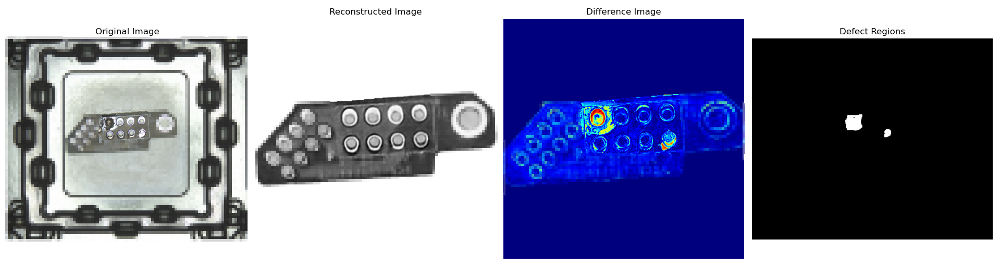

# VAE-CycleGAN Unsupervised Defect Detection

This project implements an unsupervised defect detection algorithm based on VAE-CycleGAN for image reconstruction. The algorithm combines the power of Variational Autoencoder (VAE) and CycleGAN to detect defects/anomalies in images without the need for labeled data.

# VAE-CycleGAN 无监督缺陷检测

本项目实现了一种基于 VAE-CycleGAN 的图像重建无监督缺陷检测算法。该算法结合了变分自编码器 (VAE) 和 CycleGAN 的优势，无需标注数据即可检测图像中的缺陷/异常。

## Features

- Unsupervised learning: No need for labeled anomaly data
- VAE-based image reconstruction
- CycleGAN architecture for stable training and local discrimination
- Segment Anything Model (SAM) for automatic image segmentation
- Data augmentation techniques for improved performance
- Use MAML Meta learning to train a general model for avoiding overfitting.

## 特点

- 无监督学习：无需标注异常数据。
- 基于 VAE 的图像重建。
- CycleGAN 架构，实现稳定训练和局部判别。
- Segment Anything Model (SAM) 自动图像分割。
- 数据增强技术，提升存在缺陷时重建的性能。
- 使用元学习得到更好的通用模型，避免过拟合。

## Architecture

The VAE-CycleGAN model consists of two main components:

1. **VAE Generator**: A Variational Autoencoder that learns to reconstruct normal images. It consists of an encoder and a decoder network.

2. **PatchGAN Discriminator**: A discriminator network from CycleGAN that provides local feedback on the reconstructed images.

The model is trained to minimize the reconstruction loss between the input images and their reconstructions, as well as the adversarial loss from the discriminator. In our implementation of CycleGAN, we modified the cyclic reconstruction process. Instead of the original cyclic reconstruction, we input the original image A to obtain the reconstructed image B, then input the reconstructed image B to obtain a new reconstructed image C. This modification greatly enhances the model's ability to handle images with anomalies.

The end-to-end pipeline:

```
                 ┌──────────────────────── 训练 (离线) ───────────────────────┐
raw images ──SAM cutting──> cropped targets ──manual curation──> train_images/ (normal only)
                                                                   │  augmentation + simulated defects
                                                                   ▼
                                                          VAE-GAN training
                                                                   │
                                                    saved_model/VAE.pth + Discriminator.pth
                 └───────────────────────────────────────────────────────────┘
                 ┌──────────────────────── 推理 (在线) ───────────────────────┐
image to inspect ──SAM cutting──> VAE reconstruction ──compare with original (SSIM + difference)
                                                                   │
                                              defect mask *_bin.png + mark.txt
                 └───────────────────────────────────────────────────────────┘
```

## 架构

VAE-CycleGAN 模型由两个主要组件构成：

1. **VAE 生成器**：一个变分自编码器，学习重建正常图像。它由编码器和解码器网络组成。

2. **PatchGAN 判别器**：来自 CycleGAN 的判别器网络，对重建图像提供局部反馈。

该模型通过最小化输入图像与其重建图像之间的重建损失，以及来自判别器的对抗损失来进行训练。在我们的 CycleGAN 实现中，我们修改了循环重建过程。我们不采用原始的循环重建，而是将原始图像 A 输入以获得重建图像 B，然后将重建图像 B 输入以获得新的重建图像 C。这种修改大大增强了模型处理含有异常的图像的能力。

端到端流程见上方示意图（训练离线完成，推理时只需一张待检图）。

## Project Structure

```
.
├── main.py                    # Inference entry: batch defect detection
├── train.py                   # Training entry: VAE-GAN
├── train_meta.py              # Training entry: MAML meta-learning (optional)
├── cut_targets.py             # Tool entry: batch SAM segmentation
├── generate_test_dataset.py   # Tool entry: build test dataset cache
├── defect_detection/          # Core package
│   ├── config.py              # All paths & constants (edit here, not in code)
│   ├── models/                # Network definitions (VAE, PatchGAN discriminator)
│   ├── data/                  # Dataset loading & augmentation
│   ├── training/              # Trainers (base loop, VAE, VAE-GAN)
│   ├── segmentation.py        # SAM-based target cutting (lazy model loading)
│   ├── target_discriminator.py
│   ├── meta_learning.py       # MAML
│   ├── detector.py            # Detection pipeline (SSIM + difference analysis)
│   └── image_utils.py         # Image I/O & preprocessing helpers
├── segment_anything/          # Vendored SAM library (no installation needed)
├── input/                     # Images to process (cut or detect)
├── train_images/              # Training samples (normal, after SAM cutting)
├── test_images/               # Held-out samples for the test set
└── saved_model/               # Checkpoints (SAM, VAE, discriminators)
```

## Quick Start

### 0. Environment

Python 3.10+ (verified on 3.13) with PyTorch 2.x. An NVIDIA GPU is strongly recommended (SAM ViT-L plus the 1792-channel VAE are heavy; CPU works but is very slow).

```bash
conda create -n defect-detection python=3.10 -y
conda activate defect-detection
# Install torch/torchvision for your CUDA version, e.g.:
pip install torch torchvision --index-url https://download.pytorch.org/whl/cu126
pip install -r requirements.txt
```

The `segment_anything` library is vendored in the repo — no extra install needed.

### 1. Download the SAM checkpoint (~1.2 GB)

Download [`sam_vit_l_0b3195.pth`](https://dl.fbaipublicfiles.com/segment_anything/sam_vit_l_0b3195.pth) into `saved_model/`:

```bash
mkdir -p saved_model
wget -P saved_model https://dl.fbaipublicfiles.com/segment_anything/sam_vit_l_0b3195.pth
```

### 2. Prepare your dataset

Put your raw images (containing the objects of interest, e.g. PCB photos) into `input/`, then cut the targets out with SAM:

```bash
python cut_targets.py
```

Cut results appear in `output/`. Manually review them and move the **good normal samples** into `train_images/` (defective or unseen samples can go to `test_images/`). You need at least a handful of normal samples; the more the better.

### 3. (Recommended) Build the test-set cache

```bash
python generate_test_dataset.py
```

This packs `test_images/` into `datasets/test_dataset.pt`, used as the validation set during training. Skippable — without it, 1% of the training set is held out automatically.

### 4. Train the VAE-GAN model

```bash
python train.py --epochs 60 --batch-size 10
```

Training auto-resumes from existing checkpoints in `saved_model/`. Artifacts: checkpoints (`VAE.pth`, `Discriminator.pth`), loss curves in `figure/`, reconstruction previews in `train_result/`.

### 5. Prepare the inference checkpoints

Inference needs `saved_model/Discriminator_trained.pth` (it scores how plausible each SAM cut is). Copy the discriminator you trained:

```bash
cp saved_model/Discriminator.pth saved_model/Discriminator_trained.pth   # Windows: copy
```

### 6. Run defect detection

Put the images to inspect into `input/`, then:

```bash
python main.py                     # interactive: shows a 4-panel figure per image
python main.py --no-show           # headless: saves the figure into output/
```

Outputs in `output/`:

| File | Meaning |
|---|---|
| `<name>_bin.png` | Defect mask: white background, defects in **black** |
| `<name>_compare.png` | Original / reconstructed / difference / defect panels (with `--no-show`) |
| `mark.txt` | Input-to-output filename mapping |

A lower SSIM score (printed to console and shown in the figure title) means more severe anomalies.

## 快速上手

### 0. 环境

Python 3.10+（在 3.13 上验证过）+ PyTorch 2.x。强烈建议使用 NVIDIA GPU（SAM ViT-L 和 1792 通道的 VAE 计算量大，CPU 可跑但很慢）。

```bash
conda create -n defect-detection python=3.10 -y
conda activate defect-detection
# 按本机 CUDA 版本安装 torch/torchvision, 例如:
pip install torch torchvision --index-url https://download.pytorch.org/whl/cu126
pip install -r requirements.txt
```

`segment_anything` 已随仓库内置，无需额外安装。

### 1. 下载 SAM 权重（约 1.2 GB）

下载 [`sam_vit_l_0b3195.pth`](https://dl.fbaipublicfiles.com/segment_anything/sam_vit_l_0b3195.pth) 放入 `saved_model/`：

```bash
mkdir -p saved_model
wget -P saved_model https://dl.fbaipublicfiles.com/segment_anything/sam_vit_l_0b3195.pth
```

### 2. 准备数据集

把原始图片（含感兴趣目标，例如 PCB 照片）放入 `input/`，用 SAM 批量切割：

```bash
python cut_targets.py
```

切割结果输出在 `output/`。人工筛选后把**完好的正常样本**移入 `train_images/`（有缺陷的或额外样本可放入 `test_images/`）。正常样本越多效果越好。

### 3. （推荐）生成测试集缓存

```bash
python generate_test_dataset.py
```

将 `test_images/` 打包为 `datasets/test_dataset.pt`，训练时作为验证集。此步可跳过——缺失时会自动从训练集切出 1% 作验证。

### 4. 训练 VAE-GAN 模型

```bash
python train.py --epochs 60 --batch-size 10
```

训练会自动从 `saved_model/` 中的已有权重续训。产物：权重（`VAE.pth`、`Discriminator.pth`）、损失曲线（`figure/`）、重建预览（`train_result/`）。

### 5. 准备推理权重

推理需要 `saved_model/Discriminator_trained.pth`（用于判断 SAM 切割结果是否可信），由训练得到的判别器复制而来：

```bash
cp saved_model/Discriminator.pth saved_model/Discriminator_trained.pth   # Windows: copy
```

### 6. 运行缺陷检测

把待检图片放入 `input/`，然后：

```bash
python main.py                     # 交互模式: 每张图弹出四联对比图
python main.py --no-show           # 无界面: 对比图自动保存到 output/
```

`output/` 目录输出：

| 文件 | 含义 |
|---|---|
| `<name>_bin.png` | 缺陷掩码：白底，缺陷为**黑色** |
| `<name>_compare.png` | 原图 / 重建 / 差异 / 缺陷四联图（`--no-show` 时生成） |
| `mark.txt` | 输入图与输出图的文件名对照表 |

控制台打印（以及图标题）中的 SSIM 分数越低，表示异常越严重。

## FAQ / 常见问题

**Q: Error "SAM checkpoint 不存在" / FileNotFoundError about `sam_vit_l_0b3195.pth`?**
Download it (Quick Start step 1) and place it in `saved_model/`.

**Q: Error loading `Discriminator_trained.pth` during inference?**
It is produced from your own training (Quick Start step 5). Train first, then copy `Discriminator.pth` to `Discriminator_trained.pth`.

**Q: "No target found: 没有掩码同时满足面积限制与判别器概率阈值"?**
SAM found no plausible target in that image. Lower `--min-area` (for `cut_targets.py`), adjust the cutting area/probability thresholds in `defect_detection/segmentation.py`, or use a cleaner photo.

**Q: No GPU?**
Add `--device cpu` to `main.py` / `cut_targets.py`. Everything runs, just slowly.

**Q: Want a better starting point for training (meta-learning)?**
Run `python train_meta.py` after the dataset steps; it produces `saved_model/VAE_cold_start.pth`. Rename/copy it to `VAE.pth` before `train.py` to warm-start.

**Q: 所有路径在哪里改？**
Paths and constants are centralized in `defect_detection/config.py` — change them there instead of editing code.

## References

- Variational Autoencoder (VAE)
- CycleGAN
- [Segment Anything Model (SAM)](https://github.com/facebookresearch/segment-anything)

## 参考

- 变分自编码器 (VAE)
- CycleGAN
- [Segment Anything Model (SAM)](https://github.com/facebookresearch/segment-anything)

## Effect

## 效果演示

```Python
The probability of being a real PCB is: 0.2938
Cut PCB from image successfully, take 3.729628086090088 seconds.
VAE input image loaded, take 0.01900482177734375 seconds.
VAE has regenerated the input image, take 0.08401799201965332 seconds.
Dealing with regenerated image...
Structural Similarity (SSIM) Index:  0.856191228429266
Total time cost: 3.981684923171997 seconds.
相似度: 0.856191228429266
```



## Star History

[](https://www.star-history.com/#DEVILENMO/Unsupervised-Defect-Detection-Project-Based-on-VAE-GAN-Architecture&Date)
